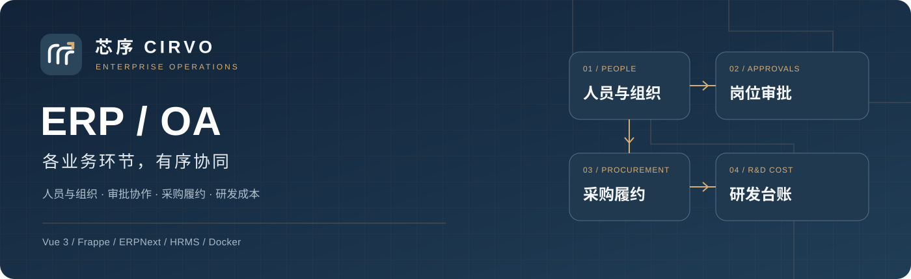
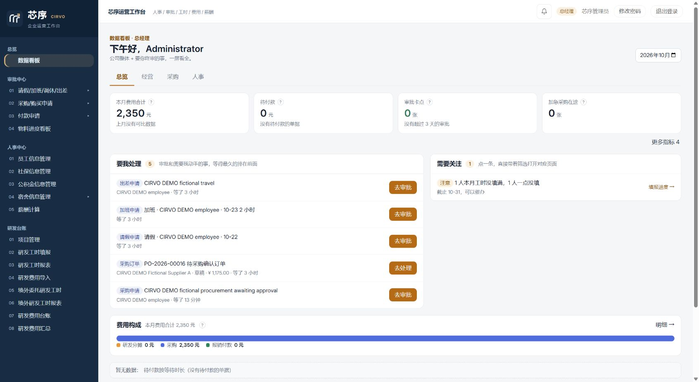
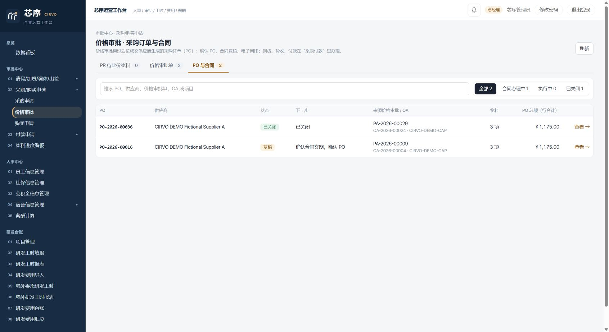
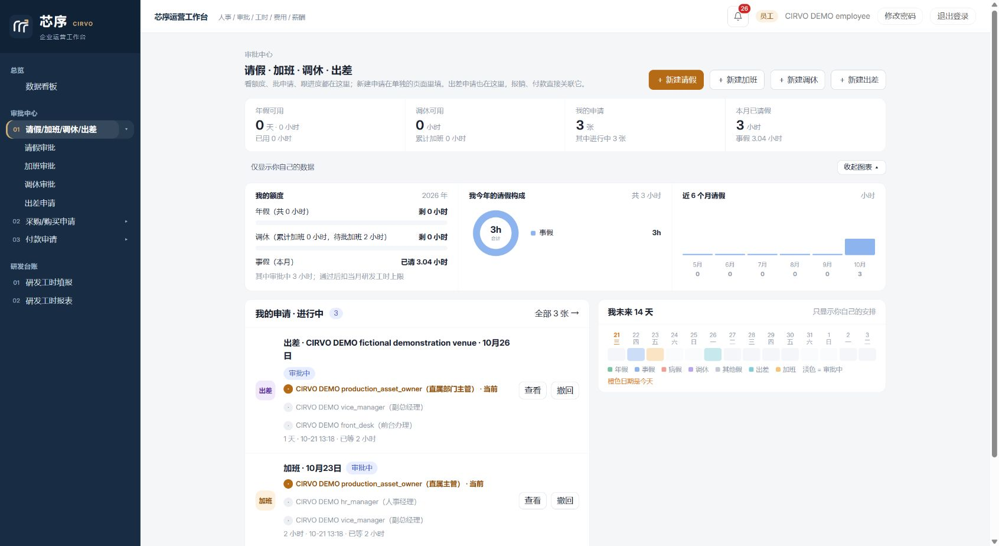
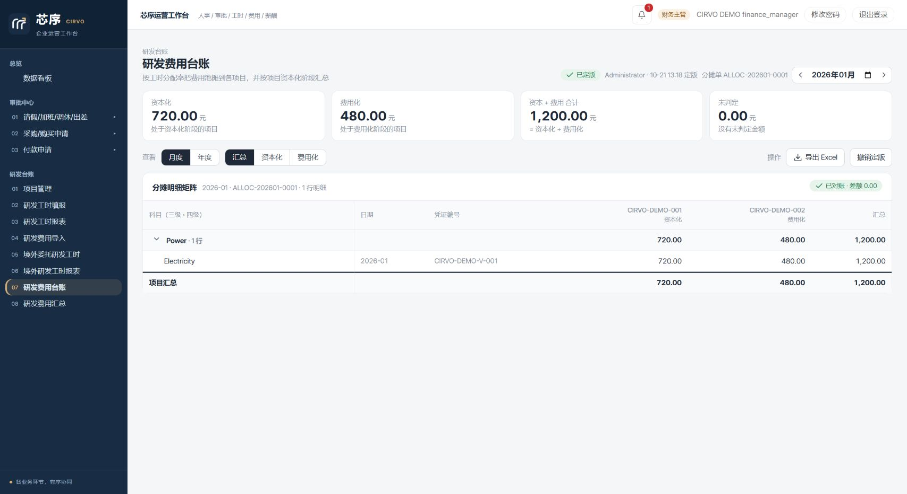
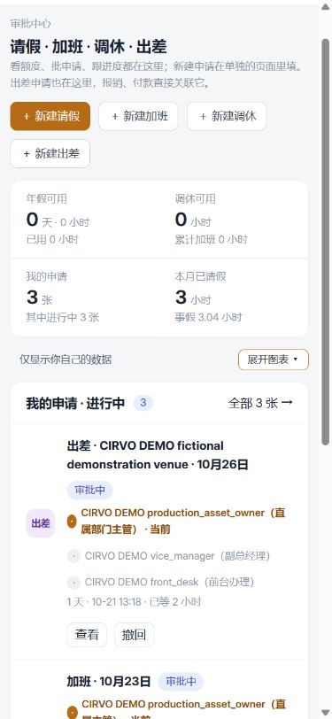

# 芯序 CIRVO · 企业 ERP/OA

**人员与组织 · 审批协作 · 采购履约 · 研发成本**

将人员考勤、审批协同、研发工时、费用核算与采购履约整合在同一套系统中。员工、主管、人事、采购和财务按角色协作，从一张申请追踪到审批、执行与业务完成。

本仓库公开项目介绍、界面截图、技术栈、运行环境和验证摘要。完整业务源码与测试实现保存在私有仓库。

[个人主页](https://github.com/Taor0006) · [CRM 项目](https://github.com/Taor0006/crm-showcase) · [技术与环境](docs/environment.md) · [验证摘要](docs/verification.md)

## 我的职责与 AI Coding

我在企业实习期间独立负责这套 ERP/OA 系统的建设，与业务部门确认流程、权限及核算口径，推进需求拆解、功能实现、验收和迭代。项目基于 Frappe、ERPNext、HRMS 等开源框架开展定制开发。

主要代码编写、修改与测试代码生成通过 Codex、Claude 等 AI 编程工具完成。我负责业务判断、规则设计、开发任务拆解及结果核对，并把运行报错、异常操作和测试反馈转化为后续修改任务。

## 同一系统中的业务协同

| 业务模块 | 主要能力与规则 |
| --- | --- |
| 人员与组织 | 员工档案、部门与汇报关系、岗位权限、入离职及交接 |
| 考勤与审批 | 请假、加班、调休、出差、月度考勤、个人待办与岗位审批 |
| 研发工时 | 人员与项目关联、工时填报和按月核对，衔接已批事假 |
| 研发核算 | 费用直接归属、按工时分摊、费用化与资本化分类、锁期及台账 |
| 采购协作 | OA 申请、采购需求 PR、询比价、价格审批与采购订单 PO |
| 履约与付款 | 合同与用印、到货、验收、分期付款、附件与发票归档 |
| 人事配套 | 薪酬、社保、公积金和住宿管理 |
| 角色工作台 | 按权限展示待办、费用、采购、人员和项目进展 |

### 代表性难点与处理

**审批与工时衔接：**根据组织关系和请假时长设置审批路线，明确员工、主管与人事的数据范围；处理假期额度的占用、使用与退回释放，让已批准的事假按日影响月度工时填报上限，并验证跨月、退回与重复审批等场景。

**研发核算一致性：**确认人员、工时、薪酬和项目费用之间的关联及核算口径，实现费用直接归属、按工时分摊及费用化、资本化分类；通过金额尾差处理、分摊前后总额核对与来源追溯验证结果。

**采购履约条件：**串联员工 OA 申请、岗位审批、PR、报价、PO、合同、到货、验收和内部付款确认，围绕角色权限、资料完整性及分期条件约束操作。

## 界面预览

### 运营与审批总览

从费用构成、采购进度和待办进入业务单据，查看需要处理的事项。

<strong>采购履约工作台</strong>

<strong>考勤与出差工作台</strong>

<strong>研发费用分摊与台账</strong>

<strong>手机考勤界面</strong>

以上图片于 2026-10-21 从实际运行的隔离验收站点采集，人员、供应商与金额均为合成数据，不代表真实经营情况。展示版本当前采用本地 Docker 环境，没有公网业务体验入口。

## 技术与运行环境

| 层次 | 项目采用的技术 |
| --- | --- |
| 业务界面 | Vue 3、Frappe UI、ECharts |
| 业务后端 | Python、Frappe 15、ERPNext 15、HRMS 15、自定义业务模型 |
| 数据与任务 | MariaDB、Redis、后台任务 |
| 构建与交付 | Docker、Compose、Vite、Yarn、GitHub Actions |
| 可选能力 | 独立部署的 PaddleOCR 发票识别服务 |

~~~mermaid
flowchart LR
    UI["Vue 3 / Frappe UI"] --> API["Frappe Python API"]
    API --> APP["ERPNext / HRMS / 业务模型"]
    APP --> DB[("MariaDB")]
    API --> TASK["Redis / 后台任务"]
    API -. "可选" .-> OCR["PaddleOCR 服务"]
~~~

[已记录依赖版本与部署方式](docs/environment.md)

## 验证与交付

2026-10-21 的项目记录包含：2896 项 Python 后端及相关检查测试、1225 项前端测试通过；全新站点安装、迁移、合成数据初始化、采购履约与内部付款闭环通过；HTTP 检查 57/57 通过，完成管理员、财务和普通员工的部分浏览器验证及手机视口检查。

验证在隔离环境中使用合成业务数据，付款为单据内部状态确认。可选 OCR 实机识别、外部系统对接、正式工资对账和生产压力测试未纳入本轮验收。具体范围见[验证摘要](docs/verification.md)。

## 展示说明

芯序 CIRVO 是项目展示品牌。公开资料只包含经过整理的说明和虚构业务截图，底层框架及依赖遵循各自的来源与授权说明。完整源码、数据库、运行凭据和真实业务附件不在本展示仓库中。
